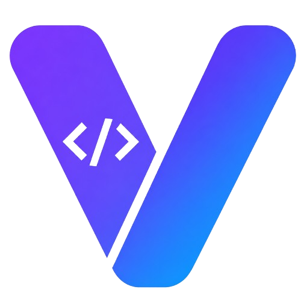
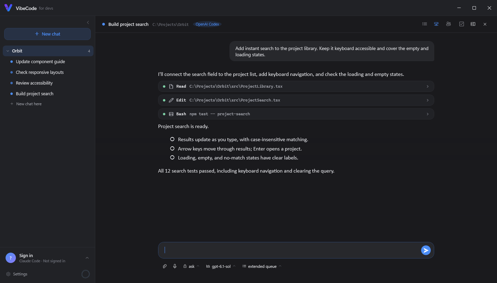
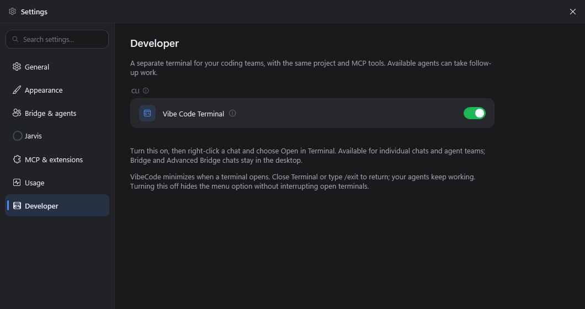
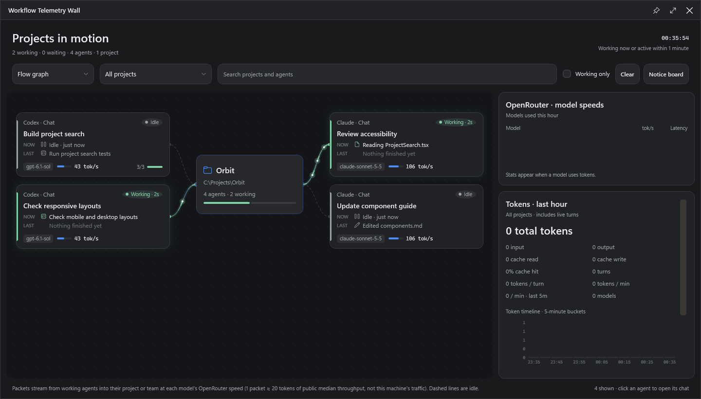

<div align="center">
  
  <h1>VibeCode</h1>
  <p><strong>Your coding agents, in one Windows workspace.</strong></p>
  <p>Claude Code &middot; OpenAI Codex &middot; GLM</p>
  <p><a href="https://github.com/SeanDishman/vibecode/releases/latest"><strong>Download for Windows</strong></a> &middot; <a href="#get-started">Get started</a> &middot; <a href="#build-it-yourself">Build from source</a> &middot; <a href="https://github.com/SeanDishman/vibecode/issues">Report a bug</a></p>
</div>



VibeCode brings coding chats, project files, tool approvals, accounts, and agent teams into a desktop app. Follow one conversation, run several agents on a project, or move a chat into **Vibe Code Terminal**. Your work stays attached to its project and conversation.

## Get started

1. Download the Windows x64 executable from the [latest release](https://github.com/SeanDishman/vibecode/releases/latest) and open it. The .NET runtime is included.
2. Open the account menu in the lower-left corner. Choose Claude Code or Codex, use the built-in CLI installer if needed, and complete the provider's sign-in. For GLM, add an API account.
3. Choose a project folder, create a chat, and describe what you want to build.

Windows 10/11 x64 is supported. The managed CLI installer runs for your Windows user and needs an internet connection. Existing compatible CLI installations also work. Provider access, subscriptions, and API usage are separate from VibeCode.

| Provider | How it connects |
| --- | --- |
| Claude Code | Official Claude Code CLI and your Claude account |
| OpenAI Codex | Official Codex CLI and your ChatGPT account |
| GLM | Your Z.ai Coding Plan, Z.ai API, or Baseten account |

## Work the way the project needs

**One chat, with the details visible.** Stream responses and reasoning, inspect tool calls and file changes, attach files, queue follow-ups, and choose the model and reasoning level for each chat. Saved conversations and recovery checkpoints help you pick work back up.

**Several agents, one project.** Bridges put agents side by side with task names, activity, messages, and per-agent accounts. Advanced Bridges add orchestrators, workers, dependencies, and review settings. Agent teams can also share a terminal. [Managed worker controls](docs/managed-worker-controls.md)

**Your development tools.** Connect MCP servers in Settings, inspect the tools an agent uses, and handle approvals in the conversation. The app includes a file viewer, task checklists, per-turn file undo, and controls to stop or steer work.

**Usage you can follow.** Watch tokens, estimated cost, and provider quota separately. Open the compact HUD or a telemetry wall for a wider view. Estimates reconcile with the usage a provider reports; unavailable quota is shown as unavailable.

## Vibe Code Terminal



The terminal is included in the public release.

1. Open **Settings > Developer > CLI** and enable **Vibe Code Terminal**.
2. Right-click an individual chat and choose **Open in Terminal**.
3. Keep working with its project, conversation, provider, and MCP tools. Type `/help` for the available commands.

Use `/agents` to inspect the team, `/message` to address an agent, `/attach` to add files, and `/requests` to review pending input or approvals. `/desktop` brings the desktop back; `/exit` closes the terminal while agents keep working. An available agent can be reused for a follow-up.

Individual chats and agent teams support Terminal. Bridge and Advanced Bridge chats use the desktop views.

## See the work happening



The **Workflow Telemetry Wall** shows recent activity across projects: which agents are working, what they are doing, and what they finished last. Filter by project or task and open an agent's chat from the wall.

Choose a graph, board, lanes, or one of the animated scenes. The wall supports a second display, full screen, and reduced motion. [Workflow wall guide](docs/workflow-telemetry-wall.md)

*Screenshots show the public app with fictional demo projects and conversations.*

## More on the desktop

- **Dictation and Jarvis:** voice input, a separate desktop-assistant conversation, and supported Windows actions. Speech services and local models are configured in Settings.
- **Optional Second Brain:** enable the extension and configure a compatible memory service to use it. Per-chat controls govern access.
- **Phone companion:** pair an Android device with the desktop. Building the optional mobile template enables APK generation; see below.
- **Workspace organization:** pin or lock chats, group them by directory, and use multiple windows or displays.

With **Run in background** enabled, closing the window leaves work in the system tray. Choose **Quit** to exit the app.

## Build it yourself

You need Windows x64, Git, and the .NET 8 and .NET 10 SDKs. The desktop targets .NET 8; some test projects use .NET 10.

```powershell
git clone https://github.com/SeanDishman/vibecode.git
cd vibecode
./scripts/Test.ps1
./scripts/Publish.ps1
```

The publish script writes a self-contained app to `artifacts/windows-x64/`. To run from source:

```powershell
dotnet run --project VibeCode.Desktop
```

The regression suite uses isolated accounts and local provider fixtures. It covers the public provider catalog, approvals, account selection, chat UI, bridges, usage, Terminal, workflow telemetry, and undo without paid model calls.

To exercise the official CLI downloads in a temporary directory without signing in:

```powershell
dotnet run --project tests/VibeCode.CliInstallTests -- --install
```

### Optional Android build

Install JDK 17 and the Android SDK specified by `mobile/VibeCodeMobile/app/build.gradle.kts`, then run:

```powershell
./scripts/Build-Mobile.ps1
./scripts/Publish.ps1 -IncludeMobile
```

The checked-in enrollment template is unpaired. Each user's pairing happens locally. Signing material, paired APKs, and enrollment credentials stay outside source control.

## Contributing

Open an [issue](https://github.com/SeanDishman/vibecode/issues) with the app version, what you expected, what happened, and steps to reproduce it. Remove credentials and private conversation content from logs and screenshots.

For a pull request, describe the behavior change and run `./scripts/Test.ps1`. Keep generated builds and local account state out of commits. VibeCode is [MIT licensed](LICENSE); provider CLIs and other dependencies retain their own licenses.
